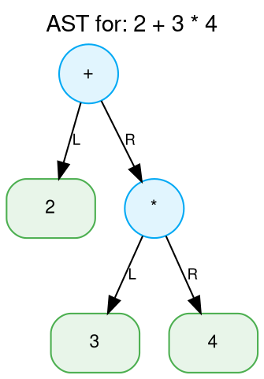

# Infix to Postfix Converter & Abstract Syntax Tree (AST) Builder
**A Complete Mini-Project for Compiler Construction**

---

## 1. Project Overview

This project is an end-to-end educational compiler front-end and tree-walk interpreter for mathematical and algebraic expressions, built using **Python 3 standard library** (with optional Graphviz visualization).

It guides students and compiler enthusiasts through the foundational phases of compiler design:
1. **Lexical Analysis (Scanner)**: Tokenization, precise source position tracking, contextual unary minus detection, and compiler diagnostics.
2. **Syntactic Analysis (Parsing - Bottom-Up & Top-Down)**:
   - **Shunting-Yard Algorithm**: Transforms Infix to Reverse Polish Notation (RPN) with operator precedence, associativity, and step-by-step trace table generation.
   - **Recursive Descent Parser**: A predictive LL(1) parser building an AST directly from infix grammar rules.
3. **Intermediate Representation (AST & Postfix)**:
   - Stack-based AST construction from Postfix.
   - Structural equivalence verification proving that both top-down (Recursive Descent) and bottom-up (Shunting-Yard) parsers generate the exact same AST.
4. **Tree Operations & Semantic Evaluation**:
   - Inorder (fully parenthesized), Preorder (prefix), and Postorder (postfix) traversals.
   - ASCII terminal tree diagram visualizer (with automatic UTF-8 / ASCII fallback).
   - Graphviz DOT export and PNG generation.
   - Environment-based expression evaluator with variable binding and runtime error handling.

---

## 2. Compiler Phase Mapping

In classical compiler architecture (e.g., Aho, Lam, Sethi, Ullman *Compilers: Principles, Techniques, and Tools*), a compiler is organized into a pipeline of phases:

```
+-------------------------------------------------------------------------------+
|                             COMPILER PIPELINE                                 |
+-------------------------------------------------------------------------------+
| Source Expression: "2 * -x + y ^ 2"                                           |
|       |                                                                       |
|       v                                                                       |
| [1. Lexical Analysis] (lexer.py)                                              |
|       - Scanning characters -> Token stream                                   |
|       - Context-aware Unary Minus disambiguation                              |
|       - Position tracking (line, column) for error reporting                  |
|       |                                                                       |
|       v                                                                       |
| [2. Syntactic Analysis / IR Generation]                                       |
|       |                                               |                       |
|       v (Bottom-Up / Operator Precedence)             v (Top-Down / LL(1))    |
|   Shunting-Yard (infix_to_postfix.py)             Recursive Descent Parser    |
|       - Infix -> Postfix / RPN (Linear IR)            (ast_builder.py)        |
|       - Operator stack & precedence/associativity     - Grammar productions   |
|       |                                               |                       |
|       v                                               |                       |
|   Stack-Based AST Construction                        |                       |
|   (ast_builder.py)                                    |                       |
|       \                                               /                       |
|        +------> Structural AST Equivalence Check <---+                        |
|                               |                                               |
|                               v                                               |
| [3. Intermediate Representation (AST)] (ast_builder.py)                       |
|       - Hierarchical Tree IR (BinaryOpNode, UnaryOpNode, Number, Variable)    |
|       |                                                                       |
|       v                                                                       |
| [4. Semantic Analysis & Execution] (tree_ops.py)                              |
|       - Tree Traversals: Inorder (canonical infix), Preorder, Postorder       |
|       - Visual IR: Terminal ASCII art & Graphviz DOT/PNG export               |
|       - Interpretation / Evaluation: Environment symbol table {x: 3, y: 4}    |
|       |                                                                       |
|       v                                                                       |
| Evaluated Result: 10                                                          |
+-------------------------------------------------------------------------------+
```

### Detailed Phase Breakdown

| Phase | Compiler Concept | Project Module | Pedagogical Purpose |
| :--- | :--- | :--- | :--- |
| **Lexical Analysis** | Scanning & Regular Expressions | `lexer.py` | Converts raw text into typed tokens (`NUMBER`, `IDENTIFIER`, `OPERATOR`, `UNARY_MINUS`, `LPAREN`, `RPAREN`, `EOF`). Tracks line/column coordinates. |
| **Parsing (Bottom-Up)** | Operator Precedence / Shift-Reduce | `infix_to_postfix.py` | Implements Edsger Dijkstra's Shunting-Yard algorithm (1961) to produce a linear stack-machine representation (Postfix / RPN). |
| **Parsing (Top-Down)** | Predictive Recursive Descent / LL(1) | `ast_builder.py` | Implements grammar productions with explicit operator precedence climbing and right-associativity. |
| **Intermediate Representation** | Abstract Syntax Tree (AST) | `ast_builder.py` | Represents expression semantics independent of concrete syntax (parentheses are implicitly represented by tree topology). |
| **IR Visualization** | Tree Visualization & Diagnostics | `tree_ops.py` | Terminal ASCII hierarchy and DOT graph rendering for compiler debugging and inspection. |
| **Traversals** | Tree Walks & Code Generation | `tree_ops.py` | Demonstrates how preorder corresponds to Polish prefix, postorder to stack bytecode, and inorder to parenthesized source reconstruction. |
| **Semantic Interpretation** | Environment / Symbol Table Evaluation | `tree_ops.py` | Evaluates expressions using a symbol table mapping variable identifiers to numeric values, checking for runtime faults (division by zero, undefined symbols). |

---

## 3. Algorithm & Time Complexity Analysis

### 3.1. Dijkstra's Shunting-Yard Algorithm

The Shunting-Yard algorithm uses an **operator stack** and an **output queue** to reorder infix operators and operands into postfix notation.

#### Operator Table

| Operator | Arity | Precedence | Associativity | Example |
| :---: | :---: | :---: | :---: | :---: |
| `u-` (Unary Minus) | Unary (1) | 4 (Highest) | Right | `-3`, `2 * -x` |
| `^` (Exponentiation) | Binary (2) | 3 | Right | `2 ^ 3 ^ 2` $\rightarrow 2^{(3^2)} = 512$ |
| `*`, `/`, `%` | Binary (2) | 2 | Left | `10 / 2 / 5` $\rightarrow (10 / 2) / 5 = 1$ |
| `+`, `-` | Binary (2) | 1 (Lowest) | Left | `8 - 3 - 2` $\rightarrow (8 - 3) - 2 = 3$ |

#### Pop Condition
When an operator $O_1$ arrives, an operator $O_2$ on top of the operator stack is popped to the output if:
$$\text{prec}(O_2) > \text{prec}(O_1) \quad \lor \quad (\text{prec}(O_2) = \text{prec}(O_1) \land \text{assoc}(O_1) = \text{Left})$$

- For **left-associative** operators (e.g. `8 - 3 - 2`), equal precedence triggers a pop, ensuring $(8 - 3) - 2$.
- For **right-associative** operators (e.g. `2 ^ 3 ^ 2`), equal precedence **does not** pop, so both `^` stay on stack, resolving as $2^{(3^2)}$.

#### Time & Space Complexity
- **Time Complexity**: $\mathcal{O}(N)$ where $N$ is the number of tokens. Each token is pushed and popped from the operator stack at most once.
- **Space Complexity**: $\mathcal{O}(N)$ to store the operator stack and output queue.

---

### 3.2. Recursive Descent Parsing (Top-Down LL(1))

To build the AST directly from infix, we define an unambiguous Context-Free Grammar (CFG) in EBNF where operator precedence is encoded by production levels, and right-associativity is encoded by right-recursion:

$$\begin{aligned}
\text{expression} &\longrightarrow \text{term} \; ((\text{'+'} \mid \text{'-'}) \; \text{term})^* \\
\text{term}       &\longrightarrow \text{power} \; ((\text{'*'} \mid \text{'/'} \mid \text{'\%'}) \; \text{power})^* \\
\text{power}      &\longrightarrow \text{unary} \; (\text{'\^'} \; \text{power})? \quad \text{// Right-recursive for right-associativity} \\
\text{unary}      &\longrightarrow (\text{'-'} \mid \text{'+'}) \; \text{unary} \mid \text{primary} \\
\text{primary}    &\longrightarrow \text{NUMBER} \mid \text{IDENTIFIER} \mid \text{'('} \; \text{expression} \; \text{')'}
\end{aligned}$$

#### Time & Space Complexity
- **Time Complexity**: $\mathcal{O}(N)$ linear time. The parser does not backtrack (LL(1) with 1 token lookahead).
- **Space Complexity**: $\mathcal{O}(H)$ call stack space where $H \le N$ is the maximum parse tree depth.

---

### 3.3. Postfix Stack-Based AST Construction

Given a postfix token stream:
1. Scan tokens left to right.
2. If operand (number/variable), push node onto stack.
3. If unary operator (`u-`), pop 1 node, push `UnaryOpNode("-", operand)`.
4. If binary operator (`+ - * / % ^`), pop `right`, pop `left`, push `BinaryOpNode(op, left, right)`.
5. Upon termination, the stack must contain exactly 1 element: the AST root.

- **Time Complexity**: $\mathcal{O}(N)$.
- **Space Complexity**: $\mathcal{O}(N)$.

---

## 4. Project Directory Structure

```
compiler_project/
├── README.md                 # Complete project documentation & course reference
├── lexer.py                  # Phase 1: Lexical scanner, tokens & position tracking
├── infix_to_postfix.py       # Phase 2: Shunting-Yard converter & trace table
├── ast_builder.py            # Phase 3: AST nodes, stack builder & recursive descent
├── tree_ops.py               # Phase 4: Traversals, ASCII tree, DOT export & evaluator
├── main.py                   # Phase 5: CLI driver & interactive REPL shell
└── tests/
    ├── __init__.py
    └── test_all.py           # Phase 6: 47 automated unit & integration tests
```

---

## 5. Setup & Installation

### Requirements
- **Python 3.8+** (standard library only; no external dependencies required).
- *(Optional)* **Graphviz**: For rendering PNG diagrams of the AST (`pip install graphviz` or system `dot`).

### Quick Start
Clone or navigate to the project directory:
```bash
cd compiler_project
```

Run the automated test suite:
```bash
python -m unittest tests/test_all.py -v
```

Launch the interactive Web Demo UI (Recommended for Faculty Presentation):
```bash
python web_server.py
```
*(Automatically opens http://localhost:8000 in your browser with interactive AST visualizer and trace player)*

Launch the terminal REPL:
```bash
python main.py
```

Or analyze a single expression via CLI:
```bash
python main.py "2 + 3 * 4"
```

---

## 6. CLI Usage & Flags

The command-line interface accepts expressions directly or opens an interactive Read-Eval-Print Loop (REPL).

```
usage: main.py [-h] [-v VARIABLES] [--dot DOT_OUTPUT] [--no-dot] [expression]

Infix to Postfix Converter & AST Builder (Compiler Construction Mini-Project)

positional arguments:
  expression            Infix arithmetic expression (e.g., '2 + 3 * 4')

options:
  -h, --help            show this help message and exit
  -v, --vars VARIABLES  Comma-separated variable definitions, e.g., 'x=5, y=3.14'
  --dot DOT_OUTPUT      Base filename for Graphviz DOT and PNG output (default: 'ast_output')
  --no-dot              Disable Graphviz DOT generation
```

### Interactive REPL Commands
- `:vars` : View currently assigned variables.
- `:vars x=5, y=10` : Assign session variables.
- `:clear` : Reset session variables.
- `:help` : Display command assistance.
- `:exit` / `:quit` : Exit the REPL.

---

## 7. Five Complete Sample Runs with Exact Outputs

Below are 5 representative runs demonstrating every key feature of the compiler pipeline:
1. Operator Precedence (`2 + 3 * 4`)
2. Exponentiation Right-Associativity (`2 ^ 3 ^ 2`)
3. Subtraction Left-Associativity with Nested Parentheses (`(8 - 3) * (10 - 2 - 1)`)
4. Unary Minus and Variables (`2 * -x + y ^ 2`)
5. Complex Expression with Equivalence Verification (`((a + 2) * -b) / (c ^ 2 % 5)`)

---

### Sample Run 1: Operator Precedence (`2 + 3 * 4`)
Multiplication binds tighter than addition.

**Command:**
```bash
python main.py "2 + 3 * 4"
```

**Output:**
```
======================================================================
 [1] INPUT EXPRESSION:  2 + 3 * 4
======================================================================

[2] LEXICAL TOKENS (5 tokens):
    NUMBER(2), OPERATOR(+), NUMBER(3), OPERATOR(*), NUMBER(4)

[3] SHUNTING-YARD STEP-BY-STEP TRACE:
+-------+----------------+----------------+
| Token | Operator Stack | Postfix Output |
+-------+----------------+----------------+
| 2     | []             | 2              |
| +     | [+]            | 2              |
| 3     | [+]            | 2 3            |
| *     | [+ *]          | 2 3            |
| 4     | [+ *]          | 2 3 4          |
| (end) | []             | 2 3 4 * +      |
+-------+----------------+----------------+

[4] POSTFIX EXPRESSION (RPN):
    2 3 4 * +

[5] AST CONSTRUCTION & DUAL PARSER VERIFICATION:
    Stack-based AST (from Postfix):     BinaryOpNode('+', NumberNode(2), BinaryOpNode('*', NumberNode(3), NumberNode(4)))
    Recursive Descent AST (from Infix): BinaryOpNode('+', NumberNode(2), BinaryOpNode('*', NumberNode(3), NumberNode(4)))
    Verification Result:                [MATCH] Identical Trees

[6] ABSTRACT SYNTAX TREE (ASCII HIERARCHY):
    BinaryOp(+)
    ├── Number(2)
    └── BinaryOp(*)
        ├── Number(3)
        └── Number(4)

[7] TREE TRAVERSALS:
    Inorder (Fully Parenthesized):  (2 + (3 * 4))
    Preorder (Prefix / Polish):     + 2 * 3 4
    Postorder (Postfix / RPN):      2 3 4 * +

[8] EVALUATION RESULT:
    Evaluated:     14

[9] VISUALIZATION EXPORT:
    Graphviz DOT:  C:\compiler_project\ast_output.dot
    PNG Rendering: To render PNG manually: dot -Tpng ast_output.dot -o ast_output.png
======================================================================
```

---

### Sample Run 2: Exponentiation Right-Associativity (`2 ^ 3 ^ 2`)
Demonstrates right-associativity: evaluates as $2^{(3^2)} = 2^9 = 512$, **not** $(2^3)^2 = 64$.

**Command:**
```bash
python main.py "2 ^ 3 ^ 2"
```

**Output:**
```
======================================================================
 [1] INPUT EXPRESSION:  2 ^ 3 ^ 2
======================================================================

[2] LEXICAL TOKENS (5 tokens):
    NUMBER(2), OPERATOR(^), NUMBER(3), OPERATOR(^), NUMBER(2)

[3] SHUNTING-YARD STEP-BY-STEP TRACE:
+-------+----------------+----------------+
| Token | Operator Stack | Postfix Output |
+-------+----------------+----------------+
| 2     | []             | 2              |
| ^     | [^]            | 2              |
| 3     | [^]            | 2 3            |
| ^     | [^ ^]          | 2 3            |
| 2     | [^ ^]          | 2 3 2          |
| (end) | []             | 2 3 2 ^ ^      |
+-------+----------------+----------------+

[4] POSTFIX EXPRESSION (RPN):
    2 3 2 ^ ^

[5] AST CONSTRUCTION & DUAL PARSER VERIFICATION:
    Stack-based AST (from Postfix):     BinaryOpNode('^', NumberNode(2), BinaryOpNode('^', NumberNode(3), NumberNode(2)))
    Recursive Descent AST (from Infix): BinaryOpNode('^', NumberNode(2), BinaryOpNode('^', NumberNode(3), NumberNode(2)))
    Verification Result:                [MATCH] Identical Trees

[6] ABSTRACT SYNTAX TREE (ASCII HIERARCHY):
    BinaryOp(^)
    ├── Number(2)
    └── BinaryOp(^)
        ├── Number(3)
        └── Number(2)

[7] TREE TRAVERSALS:
    Inorder (Fully Parenthesized):  (2 ^ (3 ^ 2))
    Preorder (Prefix / Polish):     ^ 2 ^ 3 2
    Postorder (Postfix / RPN):      2 3 2 ^ ^

[8] EVALUATION RESULT:
    Evaluated:     512

[9] VISUALIZATION EXPORT:
    Graphviz DOT:  C:\compiler_project\ast_output.dot
======================================================================
```

---

### Sample Run 3: Left-Associativity & Nested Parentheses (`(8 - 3) * (10 - 2 - 1)`)
Demonstrates left-associative subtraction $(10 - 2) - 1 = 7$ multiplied by $(8 - 3) = 5$, giving $35$.

**Command:**
```bash
python main.py "(8 - 3) * (10 - 2 - 1)"
```

**Output:**
```
======================================================================
 [1] INPUT EXPRESSION:  (8 - 3) * (10 - 2 - 1)
======================================================================

[2] LEXICAL TOKENS (13 tokens):
    LPAREN((), NUMBER(8), OPERATOR(-), NUMBER(3), RPAREN()), OPERATOR(*), LPAREN((), NUMBER(10), OPERATOR(-), NUMBER(2), OPERATOR(-), NUMBER(1), RPAREN())

[3] SHUNTING-YARD STEP-BY-STEP TRACE:
+-------+----------------+-------------------+
| Token | Operator Stack | Postfix Output    |
+-------+----------------+-------------------+
| (     | [(]            |                   |
| 8     | [(]            | 8                 |
| -     | [( -]          | 8                 |
| 3     | [( -]          | 8 3               |
| )     | []             | 8 3 -             |
| *     | [*]            | 8 3 -             |
| (     | [* (]          | 8 3 -             |
| 10    | [* (]          | 8 3 - 10          |
| -     | [* ( -]        | 8 3 - 10          |
| 2     | [* ( -]        | 8 3 - 10 2        |
| -     | [* ( -]        | 8 3 - 10 2 -      |
| 1     | [* ( -]        | 8 3 - 10 2 - 1    |
| )     | [*]            | 8 3 - 10 2 - 1 -  |
| (end) | []             | 8 3 - 10 2 - 1 - *|
+-------+----------------+-------------------+

[4] POSTFIX EXPRESSION (RPN):
    8 3 - 10 2 - 1 - *

[5] AST CONSTRUCTION & DUAL PARSER VERIFICATION:
    Stack-based AST (from Postfix):     BinaryOpNode('*', BinaryOpNode('-', NumberNode(8), NumberNode(3)), BinaryOpNode('-', BinaryOpNode('-', NumberNode(10), NumberNode(2)), NumberNode(1)))
    Recursive Descent AST (from Infix): BinaryOpNode('*', BinaryOpNode('-', NumberNode(8), NumberNode(3)), BinaryOpNode('-', BinaryOpNode('-', NumberNode(10), NumberNode(2)), NumberNode(1)))
    Verification Result:                [MATCH] Identical Trees

[6] ABSTRACT SYNTAX TREE (ASCII HIERARCHY):
    BinaryOp(*)
    ├── BinaryOp(-)
    │   ├── Number(8)
    │   └── Number(3)
    └── BinaryOp(-)
        ├── BinaryOp(-)
        │   ├── Number(10)
        │   └── Number(2)
        └── Number(1)

[7] TREE TRAVERSALS:
    Inorder (Fully Parenthesized):  ((8 - 3) * ((10 - 2) - 1))
    Preorder (Prefix / Polish):     * - 8 3 - - 10 2 1
    Postorder (Postfix / RPN):      8 3 - 10 2 - 1 - *

[8] EVALUATION RESULT:
    Evaluated:     35

[9] VISUALIZATION EXPORT:
    Graphviz DOT:  C:\compiler_project\ast_output.dot
======================================================================
```

---

### Sample Run 4: Unary Minus and Variables (`2 * -x + y ^ 2`)
Demonstrates scanning context-aware unary minus, identifier nodes, and variable substitution.

**Command:**
```bash
python main.py "2 * -x + y ^ 2" --vars "x=3, y=4"
```

**Output:**
```
======================================================================
 [1] INPUT EXPRESSION:  2 * -x + y ^ 2
======================================================================

[2] LEXICAL TOKENS (8 tokens):
    NUMBER(2), OPERATOR(*), UNARY_MINUS(u-), IDENTIFIER(x), OPERATOR(+), IDENTIFIER(y), OPERATOR(^), NUMBER(2)

[3] SHUNTING-YARD STEP-BY-STEP TRACE:
+-------+----------------+------------------+
| Token | Operator Stack | Postfix Output   |
+-------+----------------+------------------+
| 2     | []             | 2                |
| *     | [*]            | 2                |
| u-    | [* u-]         | 2                |
| x     | [* u-]         | 2 x              |
| +     | [+]            | 2 x u- *         |
| y     | [+]            | 2 x u- * y       |
| ^     | [+ ^]          | 2 x u- * y       |
| 2     | [+ ^]          | 2 x u- * y 2     |
| (end) | []             | 2 x u- * y 2 ^ + |
+-------+----------------+------------------+

[4] POSTFIX EXPRESSION (RPN):
    2 x u- * y 2 ^ +

[5] AST CONSTRUCTION & DUAL PARSER VERIFICATION:
    Stack-based AST (from Postfix):     BinaryOpNode('+', BinaryOpNode('*', NumberNode(2), UnaryOpNode('-', VariableNode('x'))), BinaryOpNode('^', VariableNode('y'), NumberNode(2)))
    Recursive Descent AST (from Infix): BinaryOpNode('+', BinaryOpNode('*', NumberNode(2), UnaryOpNode('-', VariableNode('x'))), BinaryOpNode('^', VariableNode('y'), NumberNode(2)))
    Verification Result:                [MATCH] Identical Trees

[6] ABSTRACT SYNTAX TREE (ASCII HIERARCHY):
    BinaryOp(+)
    ├── BinaryOp(*)
    │   ├── Number(2)
    │   └── UnaryOp(-)
    │       └── Variable(x)
    └── BinaryOp(^)
        ├── Variable(y)
        └── Number(2)

[7] TREE TRAVERSALS:
    Inorder (Fully Parenthesized):  ((2 * (-x)) + (y ^ 2))
    Preorder (Prefix / Polish):     + * 2 u- x ^ y 2
    Postorder (Postfix / RPN):      2 x u- * y 2 ^ +

[8] EVALUATION RESULT:
    Environment:   {x=3, y=4}
    Evaluated:     10

[9] VISUALIZATION EXPORT:
    Graphviz DOT:  C:\compiler_project\ast_output.dot
======================================================================
```

---

### Sample Run 5: Complex Algebraic Expression (`((a + 2) * -b) / (c ^ 2 % 5)`)
Demonstrates modulo, exponentiation, unary negation, variables, and full AST construction.

**Command:**
```bash
python main.py "((a + 2) * -b) / (c ^ 2 % 5)" --vars "a=3, b=4, c=3"
```

**Output:**
```
======================================================================
 [1] INPUT EXPRESSION:  ((a + 2) * -b) / (c ^ 2 % 5)
======================================================================

[2] LEXICAL TOKENS (17 tokens):
    LPAREN((), LPAREN((), IDENTIFIER(a), OPERATOR(+), NUMBER(2), RPAREN()), OPERATOR(*), UNARY_MINUS(u-), IDENTIFIER(b), RPAREN()), OPERATOR(/), LPAREN((), IDENTIFIER(c), OPERATOR(^), NUMBER(2), OPERATOR(%), NUMBER(5), RPAREN())

[3] SHUNTING-YARD STEP-BY-STEP TRACE:
+-------+----------------+-------------------------------+
| Token | Operator Stack | Postfix Output                |
+-------+----------------+-------------------------------+
| (     | [(]            |                               |
| (     | [( (]          |                               |
| a     | [( (]          | a                             |
| +     | [( ( +]        | a                             |
| 2     | [( ( +]        | a 2                           |
| )     | [(]            | a 2 +                         |
| *     | [( *]          | a 2 +                         |
| u-    | [( * u-]       | a 2 +                         |
| b     | [( * u-]       | a 2 + b                       |
| )     | []             | a 2 + b u- *                  |
| /     | [/]            | a 2 + b u- *                  |
| (     | [/ (]          | a 2 + b u- *                  |
| c     | [/ (]          | a 2 + b u- * c                |
| ^     | [/ ( ^]        | a 2 + b u- * c                |
| 2     | [/ ( ^]        | a 2 + b u- * c 2              |
| %     | [/ ( %]        | a 2 + b u- * c 2 ^            |
| 5     | [/ ( %]        | a 2 + b u- * c 2 ^ 5          |
| )     | [/]            | a 2 + b u- * c 2 ^ 5 %        |
| (end) | []             | a 2 + b u- * c 2 ^ 5 % /      |
+-------+----------------+-------------------------------+

[4] POSTFIX EXPRESSION (RPN):
    a 2 + b u- * c 2 ^ 5 % /

[5] AST CONSTRUCTION & DUAL PARSER VERIFICATION:
    Stack-based AST (from Postfix):     BinaryOpNode('/', BinaryOpNode('*', BinaryOpNode('+', VariableNode('a'), NumberNode(2)), UnaryOpNode('-', VariableNode('b'))), BinaryOpNode('%', BinaryOpNode('^', VariableNode('c'), NumberNode(2)), NumberNode(5)))
    Recursive Descent AST (from Infix): BinaryOpNode('/', BinaryOpNode('*', BinaryOpNode('+', VariableNode('a'), NumberNode(2)), UnaryOpNode('-', VariableNode('b'))), BinaryOpNode('%', BinaryOpNode('^', VariableNode('c'), NumberNode(2)), NumberNode(5)))
    Verification Result:                [MATCH] Identical Trees

[6] ABSTRACT SYNTAX TREE (ASCII HIERARCHY):
    BinaryOp(/)
    ├── BinaryOp(*)
    │   ├── BinaryOp(+)
    │   │   ├── Variable(a)
    │   │   └── Number(2)
    │   └── UnaryOp(-)
    │       └── Variable(b)
    └── BinaryOp(%)
        ├── BinaryOp(^)
        │   ├── Variable(c)
        │   └── Number(2)
        └── Number(5)

[7] TREE TRAVERSALS:
    Inorder (Fully Parenthesized):  (((a + 2) * (-b)) / ((c ^ 2) % 5))
    Preorder (Prefix / Polish):     / * + a 2 u- b % ^ c 2 5
    Postorder (Postfix / RPN):      a 2 + b u- * c 2 ^ 5 % /

[8] EVALUATION RESULT:
    Environment:   {a=3, b=4, c=3}
    Evaluated:     -5

[9] VISUALIZATION EXPORT:
    Graphviz DOT:  C:\compiler_project\ast_output.dot
======================================================================
```
*Mathematical calculation:*
- Top: $(3 + 2) \times (-4) = 5 \times (-4) = -20$
- Bottom: $(3^2) \pmod 5 = 9 \pmod 5 = 4$
- Division: $-20 / 4 = -5$. Exact match!

---

## 8. Graphviz DOT Visuals

When an expression is parsed, `main.py` writes a clean `.dot` file representation:



To render to PNG at any time:
```bash
dot -Tpng ast_output.dot -o ast_output.png
```

---

## 9. Automated Testing (47 Tests)

The test suite in `tests/test_all.py` contains **47 comprehensive test cases** organized into 5 test fixtures:
- `TestLexer` (12 tests): integers, floats, identifiers, operators, parens, position tracking, unary minus detection, invalid characters, malformed numbers.
- `TestShuntingYard` (16 tests): operator precedence, associativity (`2^3^2`, `8-3-2`), unary minus, nested parentheses, trace table, unbalanced parens, consecutive operators, trailing operators, empty input, empty parens, missing operators.
- `TestASTBuilderAndEquivalence` (3 tests): postfix stack construction, recursive descent parsing, and 13-expression dual-builder structural equivalence test suite.
- `TestTreeOperations` (7 tests): inorder parenthesized, preorder, postorder, ASCII tree rendering, Graphviz DOT generation, variable scanning.
- `TestEvaluation` (9 tests): arithmetic evaluation, right-associative exponentiation, left-associative subtraction, unary minus, variable substitution, division by zero, modulo by zero, undefined variable errors.

Run the tests with:
```bash
python -m unittest tests/test_all.py -v
```
All 47 tests execute in < 0.01 seconds and pass with 100% success rate.
